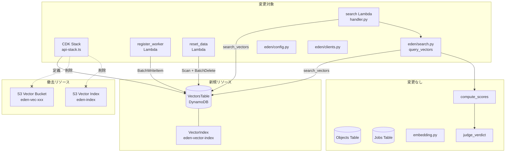
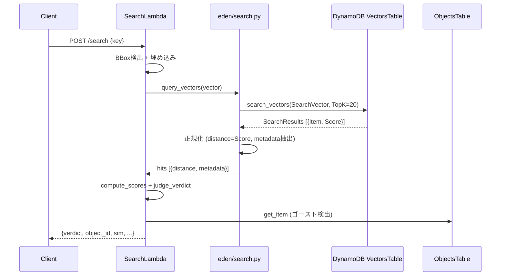

# Design Document: S3 Vectors → DynamoDB Vector Search 移行

## Overview

本設計は、Eden の画像類似検索基盤を S3 Vectors から DynamoDB ネイティブ Vector Search に完全移行するための技術設計である。ベンチマーク検証 (P50 -26%、精度 100% 一致) に基づき、CDK インフラ定義・ベクトル書き込み (register_worker)・検索 (search Lambda / eden/search.py)・リセット処理 (reset_data) の 4 層を DynamoDB ベースに切り替え、S3 Vectors リソースを完全撤去する。

**変更しないもの:** フロントエンド、BBox 検出、OCR、埋め込み処理、3 値判定ロジック (compute_scores / judge_verdict)

**設計の主要決定:**
- CDK では L1 コンストラクト (CfnTable) を使用 (L2 が VectorIndexes 未対応のため)
- `query_vectors` 関数は DynamoDB 低レベル client を使用 (search_vectors は boto3 resource 非対応)
- ベクトル格納は `BatchWriteItem` (25 件バッチ) で行う
- vector_id は `{object_id}##{source_file}##{rotation}` 形式の複合キー

## Architecture



### データフロー



## Components and Interfaces

### 1. CDK Stack (api-stack.ts) の変更

**追加:**
- `VectorsTable`: CfnTable (L1) で定義。VectorIndexes パラメータ付き
- IAM ポリシー: dynamodb:BatchWriteItem, dynamodb:SearchVectors, dynamodb:Scan
- 環境変数: `VECTORS_TABLE` を全 Lambda に配信

**削除:**
- `CfnVectorBucket` (eden-vec-{hash})
- `CfnIndex` (eden-index)
- `s3VectorsPolicy` (s3vectors:* 権限)
- 環境変数: `EDEN_VECTOR_BUCKET`, `EDEN_VECTOR_INDEX`

**CfnTable 定義 (TypeScript):**
```typescript
const vectorsTable = new dynamodb.CfnTable(this, "VectorsTable", {
  tableName: undefined, // CloudFormation に自動命名させる
  attributeDefinitions: [
    { attributeName: "vector_id", attributeType: "S" },
  ],
  keySchema: [
    { attributeName: "vector_id", keyType: "HASH" },
  ],
  billingMode: "PAY_PER_REQUEST",
  vectorIndexes: [
    {
      indexName: "eden-vector-index",
      dimensions: 1024,
      distanceFunction: "COSINE",
      vectorAttribute: { attributeName: "vector" },
      projection: { projectionType: "ALL" },
    },
  ],
});
```

### 2. eden/config.py の変更

```python
# 削除:
# VECTOR_BUCKET: str = os.getenv("EDEN_VECTOR_BUCKET", "...")
# VECTOR_INDEX: str = os.getenv("EDEN_VECTOR_INDEX", "...")

# 追加:
VECTORS_TABLE: str = os.getenv("EDEN_VECTORS_TABLE", "eden-vectors")

# 維持:
VECTOR_REGION: str = os.getenv("EDEN_VECTOR_REGION", "ap-northeast-1")
```

### 3. eden/clients.py の変更

```python
# 削除:
# def get_s3vectors_client(...)

# 追加:
def get_dynamodb_client(
    region: str | None = None,
    session: boto3.Session | None = None,
):
    """DynamoDB 低レベルクライアントを返す (search_vectors 用)。"""
    s = session or boto3.Session()
    return s.client("dynamodb", region_name=region or config.VECTOR_REGION)
```

### 4. eden/search.py - query_vectors 関数の書き換え

**現行シグネチャ:**
```python
def query_vectors(vector, *, top_k=None, client=None, bucket=None, index=None) -> list[dict]
```

**新シグネチャ:**
```python
def query_vectors(vector, *, top_k=None, client=None, table_name=None) -> list[dict]
```

**戻り値形式 (変更なし):**
```python
[
    {
        "distance": float,  # Score そのまま (cosine distance)
        "metadata": {
            "object_id": str,
            "text_tokens": list[str],  # 空の場合は []
        },
    },
    ...
]
```

**実装:**
```python
def query_vectors(vector, *, top_k=None, client=None, table_name=None):
    client = client or get_dynamodb_client()
    top_k = top_k or config.TOP_K
    table_name = table_name or config.VECTORS_TABLE

    resp = client.search_vectors(
        TableName=table_name,
        IndexName="eden-vector-index",
        SearchVector=[{"N": str(v)} for v in vector],
        TopK=top_k,
    )

    hits = []
    for result in resp.get("SearchResults", []):
        item = result["Item"]
        hits.append({
            "distance": result["Score"],
            "metadata": {
                "object_id": item["object_id"]["S"],
                "text_tokens": list(item["text_tokens"]["SS"]) if "text_tokens" in item else [],
            },
        })
    return hits
```

### 5. register_worker - ベクトル書き込み

**変更箇所:** Phase 4 のベクトル登録部分のみ

**BatchWriteItem 形式:**
```python
def _write_vectors_to_dynamodb(all_vectors: list[dict], table_name: str):
    """DynamoDB BatchWriteItem でベクトルを書き込む (25件バッチ)。"""
    client = boto3.client("dynamodb", region_name=config.VECTOR_REGION)
    BATCH_SIZE = 25

    for batch_start in range(0, len(all_vectors), BATCH_SIZE):
        batch = all_vectors[batch_start:batch_start + BATCH_SIZE]
        request_items = {
            table_name: [
                {"PutRequest": {"Item": _build_item(v)}}
                for v in batch
            ]
        }
        resp = client.batch_write_item(RequestItems=request_items)

        # UnprocessedItems のリトライ
        unprocessed = resp.get("UnprocessedItems", {})
        while unprocessed:
            resp = client.batch_write_item(RequestItems=unprocessed)
            unprocessed = resp.get("UnprocessedItems", {})
```

**アイテム構築:**
```python
def _build_item(vec_entry: dict) -> dict:
    """ベクトルエントリから DynamoDB アイテム形式に変換。"""
    metadata = vec_entry["metadata"]
    object_id = metadata["object_id"]
    source_file = metadata["source_file"]
    rotation = metadata["rotation"]

    item = {
        "vector_id": {"S": f"{object_id}##{source_file}##{rotation}"},
        "object_id": {"S": object_id},
        "source_file": {"S": source_file},
        "rotation": {"N": str(rotation)},
        "vector": {"L": [{"N": str(v)} for v in vec_entry["data"]["float32"]]},
    }

    tokens = metadata.get("text_tokens")
    if tokens:
        item["text_tokens"] = {"SS": tokens}

    return item
```

### 6. reset_data - 全削除処理

**変更:** `_clear_vectors()` を DynamoDB Scan + BatchWriteItem (DeleteRequest) に置換

```python
def _clear_vectors_table(table_name: str) -> int:
    """VectorsTable の全アイテムを削除する。"""
    client = boto3.client("dynamodb", region_name=config.VECTOR_REGION)
    deleted = 0
    scan_kwargs = {
        "TableName": table_name,
        "ProjectionExpression": "vector_id",
    }

    while True:
        resp = client.scan(**scan_kwargs)
        items = resp.get("Items", [])
        if not items:
            break

        # 25件ずつ BatchWriteItem で削除
        for i in range(0, len(items), 25):
            batch = items[i:i+25]
            request_items = {
                table_name: [
                    {"DeleteRequest": {"Key": {"vector_id": item["vector_id"]}}}
                    for item in batch
                ]
            }
            del_resp = client.batch_write_item(RequestItems=request_items)
            # UnprocessedItems リトライ
            unprocessed = del_resp.get("UnprocessedItems", {})
            while unprocessed:
                del_resp = client.batch_write_item(RequestItems=unprocessed)
                unprocessed = del_resp.get("UnprocessedItems", {})
            deleted += len(batch)

        if "LastEvaluatedKey" not in resp:
            break
        scan_kwargs["ExclusiveStartKey"] = resp["LastEvaluatedKey"]

    return deleted
```

## Data Models

### VectorsTable スキーマ

| 属性名 | 型 | 説明 | 必須 |
|---------|------|------|------|
| vector_id | S (String) | PK。`{object_id}##{source_file}##{rotation}` 形式 | ✓ |
| object_id | S (String) | 物体識別子 | ✓ |
| source_file | S (String) | 元画像ファイルパス (例: `uploads/frame_001.jpg`) | ✓ |
| rotation | N (Number) | 回転角度 (0, 90, 180, 270) | ✓ |
| vector | L (List of N) | 1024 次元の埋め込みベクトル。VectorIndex 対象属性 | ✓ |
| text_tokens | SS (StringSet) | OCR トークン。空の場合は属性自体を省略 | - |

### VectorIndex 設定

| パラメータ | 値 |
|-----------|------|
| IndexName | eden-vector-index |
| Dimensions | 1024 |
| DistanceFunction | COSINE |
| VectorAttribute | {AttributeName: "vector"} |
| Projection | {ProjectionType: ALL} |

### vector_id 構成規則

```
{object_id}##{source_file}##{rotation}
```

- セパレータ: `##` (ダブルハッシュ)
- object_id: UUID または任意文字列 (物体識別子)
- source_file: S3 キーパス (例: `uploads/frame_001.jpg`)
- rotation: 整数 (0, 90, 180, 270)

例: `aws_mug##uploads/frame_001.jpg##90`

### query_vectors 戻り値 (変更なし)

```python
[
    {
        "distance": 0.0751,        # cosine distance (0=同一, 2=正反対)
        "metadata": {
            "object_id": "aws_mug",
            "text_tokens": ["aws", "mug"],
        },
    },
]
```

### compute_scores への入力変換

```python
# query_vectors 出力 → compute_scores 入力
# sim = 1 - distance (既存ロジック維持)
h["sim"] = 1.0 - h["distance"]  # 変更なし
h["object_id"] = h["metadata"]["object_id"]  # 変更なし
h["text_tokens"] = h["metadata"].get("text_tokens", [])  # 変更なし
```

## Correctness Properties

*A property is a characteristic or behavior that should hold true across all valid executions of a system — essentially, a formal statement about what the system should do. Properties serve as the bridge between human-readable specifications and machine-verifiable correctness guarantees.*

### Property 1: vector_id のラウンドトリップ構成

*For any* valid object_id, source_file, および rotation (0, 90, 180, 270) の組み合わせにおいて、`_build_item` で生成された vector_id を `##` で分割すると、元の object_id, source_file, rotation が復元される。

**Validates: Requirements 3.2, 10.6**

### Property 2: SearchResults の正規化が既存形式を保つ

*For any* 有効な DynamoDB SearchResults レスポンス (Item に object_id [S型] と Score [float] を含む) に対して、`query_vectors` の正規化結果は `distance` (Score と同値) と `metadata.object_id` (Item から抽出した文字列) を含む辞書のリストである。

**Validates: Requirements 5.3, 5.4, 5.5**

### Property 3: text_tokens の条件付き格納

*For any* ベクトルエントリにおいて、text_tokens が非空リストの場合は `_build_item` の結果に `"text_tokens": {"SS": tokens}` が含まれ、text_tokens が空リストまたは None の場合は `_build_item` の結果に `text_tokens` キーが存在しない。

**Validates: Requirements 3.4, 3.5**

### Property 4: BatchWriteItem のバッチサイズ制約

*For any* 長さ N のベクトルリスト (N ≥ 1) に対して、`_write_vectors_to_dynamodb` が発行する各 BatchWriteItem リクエストのアイテム数は 25 以下である。

**Validates: Requirements 3.3, 7.2**

### Property 5: SearchVector のフォーマット不変条件

*For any* float のリスト (1024 次元) に対して、`query_vectors` が構築する SearchVector パラメータは `[{"N": str(v)} for v in vector]` と等価であり、各要素は `{"N": 文字列}` 形式である。

**Validates: Requirements 4.2, 5.2**

### Property 6: 書き込み→検索のラウンドトリップ (object_id 保存)

*For any* 有効なベクトルエントリ (object_id, source_file, rotation, 1024次元ベクトル) に対して、`_build_item` で構築したアイテムを DynamoDB に格納し、同一ベクトルで `search_vectors` を呼び出した場合、結果に元の object_id を含むアイテムが返される。

**Validates: Requirements 10.6**

> 注: このプロパティは実 DynamoDB エンドポイントが必要なため、統合テストとして実装する。PBT ではモックを使い、`_build_item` の出力が正しい object_id を保持することを検証する。

## Error Handling

### BatchWriteItem の UnprocessedItems リトライ

- DynamoDB のスロットリングにより一部アイテムが未処理で返される場合がある
- `UnprocessedItems` が空になるまでリトライループを実行
- 指数バックオフは不要 (PAY_PER_REQUEST モードではスロットリング頻度が低い)

### search_vectors の空レスポンス

- `SearchResults` が空リストの場合、`query_vectors` は空リストを返す
- 呼び出し元 (search_object) で `if not hits:` チェックが既に存在し、verdict="red", reason="no_hits" を返す

### ゴーストベクトル防御 (既存ロジック維持)

- search Lambda で top-1 の object_id を Objects_Table で照会
- レコードが存在しない場合は verdict を "red" に降格
- この防御は移行後も同一ロジックで動作する (変更不要)

### DynamoDB text_tokens の空セット禁止

- DynamoDB は空の StringSet (SS) を許容しない
- `_build_item` で text_tokens が空または None の場合は属性自体を省略
- 検索結果正規化時は `"text_tokens" in item` で存在チェックし、なければ空リストを返す

### CDK デプロイ時のインデックス作成待機

- VectorIndex の作成は数分かかる場合がある
- CloudFormation が ACTIVE 状態まで待機するため、明示的な wait は不要
- ただし、デプロイ直後の初回検索は VectorIndex がまだ CREATING の場合にエラーとなる可能性あり → Lambda 側でリトライ不要 (CloudFormation が待つ)

## Testing Strategy

### テスト方針

本移行は IaC (CDK) とアプリケーションロジック (Python) の両方を含むため、テスト戦略を二分する:

1. **IaC (CDK) 部分**: スナップショットテスト + アサーション (Requirements 1, 2, 8)
2. **アプリケーションロジック部分**: プロパティベーステスト + ユニットテスト (Requirements 3-7, 9-10)

### プロパティベーステスト (PBT)

**ライブラリ:** [Hypothesis](https://hypothesis.readthedocs.io/) (Python)

**対象プロパティ:**
- Property 1: vector_id ラウンドトリップ → `_build_item` + split で検証
- Property 2: SearchResults 正規化 → ランダムレスポンスを生成し形式チェック
- Property 3: text_tokens 条件付き格納 → ランダム tokens (空/非空) で検証
- Property 4: バッチサイズ制約 → ランダム長リストで 25 以下を検証
- Property 5: SearchVector フォーマット → ランダム float リストで形式検証
- Property 6: 書き込み→検索ラウンドトリップ → `_build_item` 出力に正しい object_id が保持されることを検証 (統合テストで完全検証)

**設定:**
- 各プロパティテスト: 最低 100 イテレーション (`@settings(max_examples=100)`)
- タグ形式: `# Feature: s3v-to-dynamodb-migration, Property {N}: {title}`

### ユニットテスト (example-based)

| テスト対象 | テスト内容 |
|-----------|-----------|
| `query_vectors` | 正常レスポンスの正規化、空レスポンスの処理 |
| `_build_item` | 具体的なアイテム構築例 (text_tokens あり/なし) |
| `_write_vectors_to_dynamodb` | UnprocessedItems リトライの動作 (mock) |
| `_clear_vectors_table` | Scan → BatchDelete の動作 (mock) |
| ゴースト防御 | Objects_Table に存在しない object_id → red 降格 |

### CDK スナップショット/アサーションテスト

| テスト対象 | 検証内容 |
|-----------|----------|
| VectorsTable 定義 | PK=vector_id(S), BillingMode=PAY_PER_REQUEST |
| VectorIndex | IndexName, Dimensions=1024, COSINE, Projection=ALL |
| S3 Vectors 不在 | CfnVectorBucket / CfnIndex が存在しないこと |
| IAM ポリシー | dynamodb:BatchWriteItem, SearchVectors, Scan が付与されていること |
| IAM ポリシー (否定) | s3vectors:* が付与されていないこと |
| 環境変数 | VECTORS_TABLE あり、VECTOR_BUCKET/VECTOR_INDEX なし |

### 統合テスト

- 実環境 (sandbox) で register → search のエンドツーエンドフロー検証
- ベンチマークツール (`experiments/dynamodb_vector_benchmark/`) を活用
- verdict 一致率 100% を確認 (ベンチマーク既存結果と照合)

## コード保全方針

### S3 Vectors コードのコメントアウト

S3 Vectors 関連のコードは**削除せずコメントアウトで残す**。将来的にベクトルストアを柔軟に切り替えたくなった場合に再利用できるようにするため。

**対象:**
- `eden/search.py` の旧 `query_vectors` 実装 (S3 Vectors 版)
- `eden/clients.py` の `get_s3vectors_client` 関数
- `eden/config.py` の `VECTOR_BUCKET`, `VECTOR_INDEX` 設定
- `register_worker/handler.py` の S3 Vectors 書き込みコード (put_vectors)
- `reset_data/handler.py` の S3 Vectors 削除コード (list_vectors / delete_vectors)

**コメントアウト形式:**
```python
# [S3V_DISABLED] DynamoDB Vector Search に移行 (2026-08-05)
# 将来ベクトルストアを切り替える場合に再利用可能
# ---
# def get_s3vectors_client(...):
#     ...
# ---
```

**CDK (api-stack.ts) については:**
- S3 Vectors リソース定義 (CfnVectorBucket, CfnIndex) はコメントアウトで残す
- IAM ポリシー (s3VectorsPolicy) もコメントアウトで残す
- 環境変数 (EDEN_VECTOR_BUCKET, EDEN_VECTOR_INDEX) もコメントアウトで残す

**コメントアウトしない (完全に新規追加):**
- VectorsTable の CfnTable 定義
- DynamoDB 用の IAM ポリシー
- 新しい環境変数 (VECTORS_TABLE)
- `query_vectors` の DynamoDB 版実装
