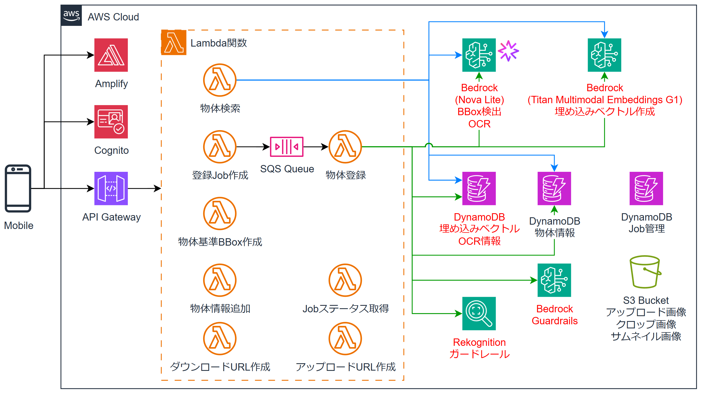

# Eden ― 物の情報をシェアするアプリ

**スマホのカメラで撮影した物体を登録し、誰かが同じ物を撮影すると、その物に紐づいた情報を表示するWebアプリです。**  
**このリポジトリでは、VLMとベクトル検索を組み合わせて、光の加減や撮影角度が違っても同じ物体を同定する物体登録・検索基盤をAWS上に構築します。**

次のような特徴があります。

- Amazon Bedrock Nova Liteによる物体検出（BBox）と文字抽出
- Amazon Titan Multimodal Embeddingsと4方向回転・CLAHE光正規化による、角度や光の変化に強いベクトル登録
- DynamoDB Vector Searchによるベクトル検索
- 類似度・マージン・文字一致を組み合わせた緑／黄／赤の3値判定
- 動画のように連続撮影したフレームからブレや類似フレームを除外し、代表的なフレームだけを登録
- SQSとLambdaによる非同期の登録処理
- Amazon Rekognitionによる顔・人物・不適切画像の登録拒否と、Bedrock Guardrailsによるコメントのチェック
- Amplify Gen2によるフロントエンド・バックエンドの構築
- Amazon Cognitoによる招待制の認証

発表資料「[AWSで物の情報をシェアするアプリつくってみた ―VLMとベクトル検索で、角度を問わず物体同定―](https://www.docswell.com/s/kkmtyyz/5PRXME-2026-08-08-205601)」にて詳しく解説しています。

## 動作イメージ

### 物体の登録
1. 物体の周りを動きながらカメラで連続撮影
2. ブレたフレームや似たフレームを除外し、代表画像を選択
3. 物体の名前や説明を入力して登録
4. バックエンドが物体を追跡し、選定したフレームをベクトル化して保存

### 物体の検索
1. カメラで物体を撮影
2. 写っている物体ごとに判定結果を枠で表示
   - 緑：登録済みの物体。情報の閲覧と追加が可能
   - 黄：登録済みの物体の候補。ユーザーが確認すると、撮影画像をその物体に追加登録
   - 赤：未登録の物体。新規登録へ移動

## アーキテクチャ図



## ディレクトリ構成
```
.
├── amplify  # Amplify Gen2バックエンド
│   ├── auth        # Cognitoの設定
│   ├── custom      # API Gateway、Lambda、SQS、DynamoDB、S3などのCDKスタック
│   └── functions   # Lambda関数ソースコード
├── app      # Next.jsフロントエンド
├── eden     # 検出・埋め込み・検索・判定などのPython共通パッケージ（Lambdaレイヤー）
├── experiments  # 精度検証やベンチマークのスクリプト
│   └── dynamodb_vector_benchmark  # S3 VectorsとDynamoDB Vector Searchの比較ベンチマーク
├── presentation # 発表資料の作成に使用したスクリプトと図
└── .kiro        # Kiroのspecとsteeringファイル
```

## デプロイ方法

### 前提条件

- Node.jsとPython 3.12が使用できる必要があります
- Amazon BedrockでNova Lite（東京リージョン）とTitan Multimodal Embeddings（us-east-1）が利用できる必要があります

### デプロイ
1. このリポジトリをAmplify HostingのCI/CDでデプロイ。サンドボックスの場合は `$ npx ampx sandbox` を実行

2. 作成された `migrate_vectors` Lambda関数を以下のペイロードで実行し、DynamoDBのベクトルテーブルを作成  
   CloudFormationがDynamoDBのベクトルインデックスに未対応のため、Lambda関数から作成しています
   ```bash
   $ aws lambda invoke --function-name <関数名> --cli-binary-format raw-in-base64-out \
       --payload '{"confirm":true,"mode":"create-table"}' out.json
   ```

3. Cognitoユーザープールにユーザーを作成  
   招待制のためセルフサインアップは無効です

### 動作確認
1. アプリへスマホのブラウザでアクセスし、ログイン

2. 登録画面で物体を撮影して登録

3. 検索画面で同じ物体を撮影し、登録した情報が表示されることを確認

## License
[MIT](./LICENSE-MIT)
